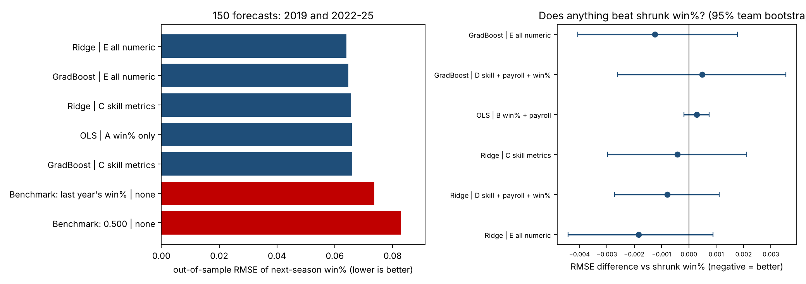

# Forecasting MLB Win Percentage: Do Underlying Metrics and Payroll Add Anything?

Out-of-sample forecasts of a team's next-season win percentage from this season's results, Statcast-based skill metrics and payroll. Rolling-origin evaluation, five model families, and paired bootstrap tests against honest benchmarks. Extends my capstone (`mlb-contract-efficiency`), which found payroll rewards overall offense but not isolated power, and that offense and run prevention strongly explain wins within a season. This repo asks the forecasting version: **does any of it help predict next year?**

## Result in one paragraph

Every model beats "next year equals last year's win%" (RMSE 0.074) and beats "everyone wins 50%" (RMSE 0.083), with models landing at 0.064 to 0.069. But almost all of that gain is **regression to the mean**: a one-variable regression on last year's win% (RMSE 0.0659) already captures it. Adding underlying skill metrics (xwOBA, ISO, xERA, FIP, DEF), payroll, or all 24 numeric variables, or using ridge, lasso, random forest or gradient boosting, moves RMSE by at most 0.003 (the best model is 0.0018 better, the worst 0.0032 worse), and no difference against the one-variable model is statistically distinguishable from zero (95% team-cluster bootstrap intervals all include 0). Payroll adds nothing once last year's win% is known.

## Setup

- **Data:** 30 teams, 2015 to 2025, from the capstone dataset (FanGraphs and Statcast team metrics, Opening Day payroll).
- **Unit:** season t features predict the same team's win % in t+1. The 60-game 2020 season is dropped as both a predictor and a target, leaving 240 pairs (2015-16 to 2018-19 and 2021-22 to 2024-25).
- **Evaluation:** rolling origin. Each target season is forecast with models fit only on earlier targets. Scored on 2019, 2022, 2023, 2024 and 2025 (150 forecasts). Nothing is tuned on the test years; ridge and lasso choose their penalty by cross-validation inside the training pairs, and the tree models use fixed settings.
- **Feature sets:** A last-year win% | B win% + log payroll | C skill metrics (xwOBA, ISO, xERA, FIP, DEF) | D skill + payroll + win% | E all 24 numeric variables.
- **Benchmarks:** 0.500 for every team; last year's win%; and the one-variable regression (set A), the fair "shrunk win%" benchmark.
- **Inference:** paired bootstrap that resamples teams (keeping each team's forecasts together) for the RMSE difference between two models.

## Results (out-of-sample, 150 forecasts)

| Model | Features | RMSE | Out-of-sample R-squared vs 0.500 |
|---|---|---|---|
| Ridge | E all numeric | 0.0641 | 0.40 |
| Gradient boosting | E all numeric | 0.0647 | 0.39 |
| Ridge | C skill metrics | 0.0655 | 0.38 |
| OLS | A win% only (shrunk) | 0.0659 | 0.37 |
| Benchmark | last year's win% | 0.0737 | 0.21 |
| Benchmark | 0.500 | 0.0829 | 0.00 |

Full list: `results/forecast_scores.csv`. Paired tests: `results/paired_rmse_differences.csv` (for example, ridge on all variables vs shrunk win%: -0.0018, 95% interval -0.0044 to +0.0009).



## Limits

- **Small sample.** 150 forecasts and 30 teams. The study can rule out large gains from extra variables, not tiny ones. Intervals of about 0.003 RMSE are consistent with a real improvement of that size.
- **Selection.** The top row of the table is the best of 22 candidate models on these same test years, so its rank is optimistic. The bootstrap comparisons against the one-variable model are the better guide.
- **Team-season metrics only.** No player-level data, so no roster changes, injuries, trades or aging. A model that sees next year's roster would do better. This is a statement about what last year's team totals can and cannot tell you.
- **In-sample importance** (`results/feature_importance_in_sample.csv`) is descriptive and fit on all pairs, so do not read it as out-of-sample evidence.
- **Overlap with the capstone.** The capstone showed within-season association; forecasting is a harder, different test, and the answer differs.

## Run

```bash
pip install -r requirements.txt
python python/forecast.py
```

Author: Samuel Essery, B.S. Quantitative Economics, Providence College.
